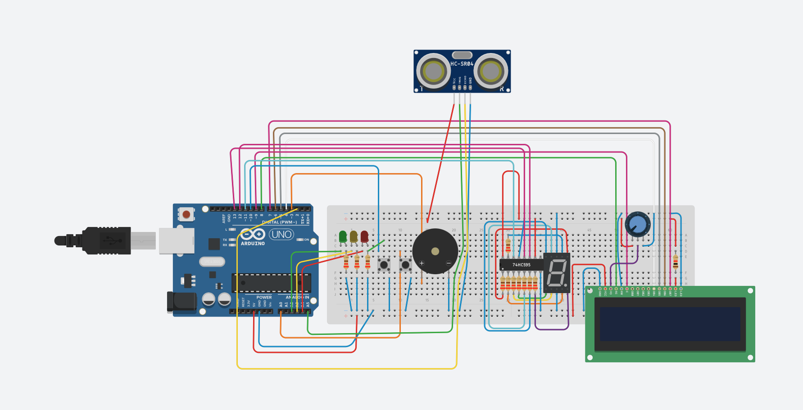
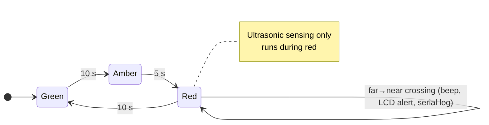
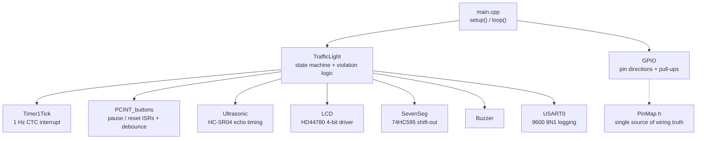

# 🚦 RedLight Sentinel

**A red-light camera on an Arduino Uno, written at the register level.**

[](https://github.com/dkabduli/redlight-sentinel/actions/workflows/build.yml)


RedLight Sentinel is a traffic-light controller that also watches for cars that run the red. It cycles green → amber → red and shows a countdown on a 7-segment display and the current phase on a 16×2 LCD. During red, an HC-SR04 ultrasonic sensor checks the stop line. When an object moves from the far zone into the near zone, the system beeps, shows a violation message on the LCD, and logs the distance over serial.

The drivers write to the ATmega328P registers directly: GPIO through `DDRx/PORTx/PINx`, a hardware-timer 1 Hz tick, pin-change interrupts for the buttons, a polled USART, and bit-banged drivers for the HD44780 LCD and 74HC595 shift register. The project doesn't use `digitalWrite`, `delay()` in the main loop, or third-party libraries.

> Final project for **NET3001 (Embedded Systems)** at Carleton University, Winter 2026, Group 19.



---

## Features

| | |
|---|---|
| **Traffic cycle** | 10 s green → 5 s amber → 10 s red, looping forever |
| **Countdown display** | Seconds remaining on a 7-segment display driven by a 74HC595 |
| **Status LCD** | 16×2 HD44780 in 4-bit mode shows the phase and violation alerts |
| **Red-light detection** | HC-SR04 edge detection with a far zone (≥ 45 cm) and a near zone (≤ 18 cm) |
| **Alerts** | Buzzer beep, 2-second LCD banner, and a `VIOLATION dist=NN cm` serial log |
| **Controls** | **Pause/Resume** and **Reset** buttons on pin-change interrupts with software debounce |
| **Non-blocking timing** | Timer1 CTC interrupt sets a 1 Hz flag, so the main loop never sleeps |

## How it works

### State machine



- **Pause** freezes the countdown and the violation check. Pressing it again resumes.
- **Reset** jumps back to green with a full 10 s and re-arms the detector.

### Violation detection

A plain "is something close?" check would fire on every loop while a car sits at the line. The detector looks for a **transition** instead:

1. During red, sample the distance on every loop pass. Ignore timeouts, which return `0`.
2. If the detector is **armed**, the previous sample was **≥ 45 cm**, and the current sample is **≤ 18 cm**, count it as a **violation**.
3. **Disarm** after firing, so one car only triggers one alert.
4. **Re-arm** once the reading goes back to ≥ 45 cm, which means the lane is clear.
5. On entering red, reset the previous sample to `999` so a car already waiting at the line doesn't trigger a false alert.

### Firmware architecture



Each peripheral is a small C-style module: a header that declares the public API and a `.cpp` file that keeps its state and helpers `static`, so they stay private to that file. `loop()` only calls `TrafficLight_step()`. Each step:

1. consumes any debounced button clicks,
2. consumes a pending 1 s tick, which counts down, changes phase, or times out the violation banner,
3. polls the ultrasonic sensor if the light is red.

The interrupt handlers only set a `volatile` flag. The main loop reads and clears each flag inside a short `cli()`/`SREG` restore block.

## Hardware

### Bill of materials

- Arduino Uno (ATmega328P @ 16 MHz)
- HC-SR04 ultrasonic distance sensor
- 16×2 HD44780 character LCD and a contrast potentiometer
- Common-cathode 7-segment display, 74HC595 shift register, and segment resistors
- Green, amber, and red LEDs with current-limiting resistors
- 2 × momentary push buttons (they use the internal pull-ups, so no external resistors)
- Piezo buzzer
- Breadboard and jumper wires

### Pin map

The authoritative mapping is in [`include/PinMap.h`](include/PinMap.h). To rewire the circuit, edit that file and nothing else.

| Function | Arduino pin | AVR port | Notes |
|---|---|---|---|
| Green LED | A2 | PC2 | |
| Amber LED | A3 | PC3 | |
| Red LED | A4 | PC4 | |
| Pause button | D10 | PB2 | PCINT2, active-low, internal pull-up |
| Reset button | A0 | PC0 | PCINT8, active-low, internal pull-up |
| Buzzer | D3 | PD3 | |
| Ultrasonic TRIG | A5 | PC5 | 10 µs pulse |
| Ultrasonic ECHO | D2 | PD2 | pulse width ÷ 58 = cm |
| 74HC595 SER | D11 | PB3 | serial data |
| 74HC595 SRCLK | D12 | PB4 | shift clock |
| 74HC595 RCLK | D13 | PB5 | latch |
| LCD RS | D8 | PB0 | |
| LCD EN | D9 | PB1 | |
| LCD D4–D7 | D4–D7 | PD4–PD7 | 4-bit bus |

## Getting started

You need [PlatformIO](https://platformio.org/), either the VS Code extension or the CLI.

Build the firmware:

```bash
pio run
```

Build it and flash a connected Uno:

```bash
pio run -t upload
```

Open the serial log at 9600 baud:

```bash
pio device monitor
```

Running a car through the red light prints something like:

```
VIOLATION dist=14 cm
```

## Project structure

```
.
├── include/            Public headers, one per module, plus PinMap.h
├── src/
│   ├── main.cpp        setup(): init order; loop(): TrafficLight_step()
│   ├── TrafficLight.cpp  Phase state machine and red-light detection
│   ├── Timer1Tick.cpp  1 Hz Timer1 CTC interrupt
│   ├── PCINT_buttons.cpp  Pause/reset interrupts and debounce
│   ├── Ultrasonic.cpp  HC-SR04 trigger and echo measurement
│   ├── LCD.cpp         HD44780 4-bit driver
│   ├── SevenSeg.cpp    74HC595 shift-out and digit segment table
│   ├── USART0.cpp      9600 8N1 serial output
│   ├── Buzzer.cpp      Single-beep alert
│   └── GPIO.cpp        Pin directions and safe startup levels
├── docs/
│   ├── report.pdf      Original course report
│   └── images/         Circuit diagram (Tinkercad)
└── platformio.ini
```

## Design decisions

- **Registers instead of the Arduino API.** Writing the registers directly makes every peripheral's behaviour explicit and keeps timing predictable, which was the point of the course.
- **Interrupts only set flags.** The ISRs never call the LCD, serial, or the delay functions. All the slow work happens in the main loop.
- **Fixed-width types.** `uint8_t` and `uint16_t` keep the size of every variable and register value exact on an 8-bit MCU.
- **One file for wiring.** `PinMap.h` holds every `DDR/PORT/PIN/bit` macro, and the drivers only use those names.
- **Fixed-width LCD writes.** `LCD_line1`/`LCD_line2` always write 16 characters and pad with spaces, so older text never shows through.

## Known limitations and ideas for next time

- The 7-segment display has one digit, so the first second of each 10 s phase shows **9** instead of **10**.
- The button debounce waits until the button is released, so holding a button stalls the loop for that time.
- Echo timing busy-waits for up to ~30 ms per read. **Timer1 input capture** would measure the echo in hardware.
- The zone thresholds (45 cm and 18 cm) are compile-time constants. A **serial calibration mode** would allow tuning them on site.

## Team

| Member | Contributions |
|---|---|
| **Abdul Rehman** | Tinkercad circuit design, serial testing, demo video |
| **Isaac Abdile** | Hardware build, firmware, LCD/7-segment drivers, report |

See the [full project report](docs/report.pdf) for the original write-up.
